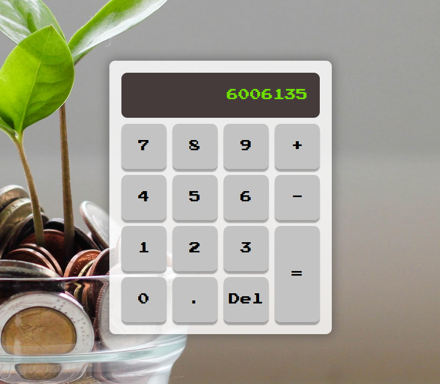

# Calculatrice

Vous devez recréer le plus fidèlement possible la maquette suivante : 

<figure markdown>
  {.center .shadow}
  <figcaption></figcaption>
</figure>

## Image d'arrière-plan

- Utilisez l'image de votre choix en guise d'arrière-plan.
- L'image ne doit pas se répéter et couvrir toute la page.

## Disposition

- La calulatrice doit être centrée horizontalement et verticalement.
- La couleur de fond de la calculatrice doit être transparente.
- L'écran noir et les boutons sont des divs.
- Utilisez la stratégie de votre choix pour disposé les boutons et l'écran d'affichage.
- Utilisez la police [Press Start 2P](https://fonts.google.com/specimen/Press+Start+2P?query=Press+Start+2P).
- Créez une animation qui donnera l'effet qu'on enfonce le bouton quand on clique sur le bouton ou qu'on appuie sur la touche correspondante.

<video controls class="center">
  <source src="../../ressources/bonus_calculatrice.mp4" type="video/mp4">
</video>

!!! Astuce

    Dans mon exemple mes boutons on un box shadow dans le bas, c'est ce qui leur donne un effet surélevé. Quand on clique sur un bouton, je fais une transition vers le bas équivalent à la largeur du box-shadow et j'annule celui-ci. Ça donne l'effet qu'on enfonce le bouton.

## Fonctionnalités

- Quand on clique sur un bouton chiffre ou qu'on appuie sur la touche correspondante au clavier, affichez le nombre dans l'écran de résultat. Inspirez-vous du fonctionnement d'une vrai calculatrice. Par exemple si on entre consécutivement 1 et 2, à l'écran nous aurons 12. 
- Quand on clique sur une touche opération (addition ou soustraction), le nombre à l'écran s'éfface et est stocké en mémoire (dans une variable ou un tableau). Ensuite le second nombre peut être saisie. 
- Quand on clique sur la touche =, on effectue l'opération souhaitée et on affiche le résultat.
- Quand on clique sur la touche Del, on efface l'affichage et tous les calculs qui pourrait y avoir en mémoire.

!!! hint ""
  
    Vous pouvez aller plus loin et permettre plusieurs opérateurs avant de résoudre l'équation (2 + 3 * 6 = 36) 
    ou bien faire la somme à chaque fois qu'on entre un nouvel opérateur et l'afficher (2 + 3 (6) * 6 = 36).
    Dans les deux cas vous pouvez résoudre les opérateurs dans l'ordre sans respecter la priorité des opérations (multiplication et division en premier)