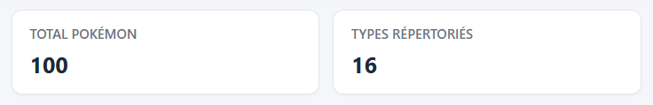
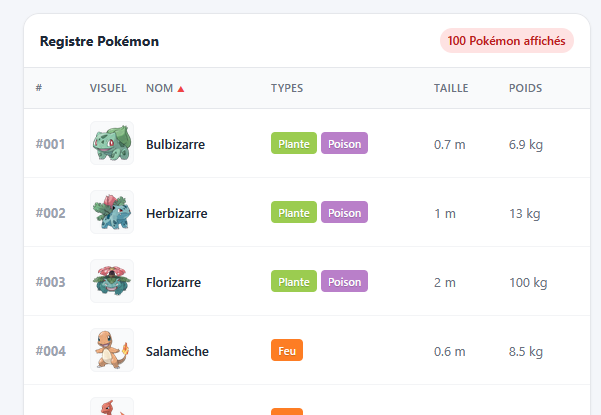
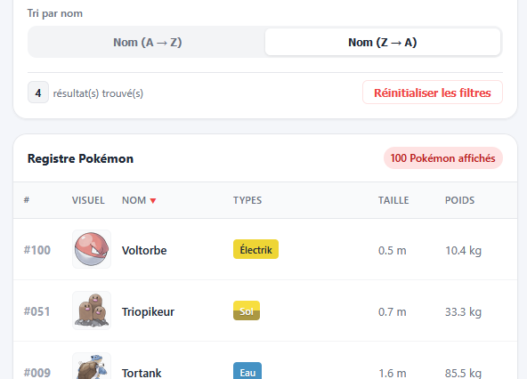

# Pokémon Dash

## Consignes générales

- Téléchargez et décompressez le projet de départ disponible ici : 
- Avant de commencer les modifications, je vous conseille de vous faire une copie de sauvegarde du projet de départ.
- Vous devez essayer de conserver l'esthétique du site (couleur, disposition, etc.)
- Vous pouvez modifier tous les fichiers à l'exception de **pokemon.js** qui contient la liste des pokemons à afficher.
- Si vous voulez ajouter des règles css, je vous conseille de le faire dans le fichier **extra.css**
- Apportez au site les modifications suivantes et ajoutez les fonctionnalités décrites.
- Dans certaines sections, je vous propose deux niveaux d'instructions ("Normal" et "Super Saiyan" pour plus de défis), à vous de choisir le niveau qui vous convient.

## Ajustement de l'entête

- Dans l'entête de la page, ajustez les valeurs **Total Pokémon** et **Type répertoriés** selon ce que vous avez dans le tableau d'objets `pokemons`.
- Ces informations sont indépendantes du filtre, elles représentent toujours les valeurs du tableau de base.

<figure markdown>
  {.center .shadow}
  <figcaption>Vous devriez avoir ces valeurs</figcaption>
</figure>

!!! hint "Astuce"

    Pour calculer le nombre de type distinct, vous pourriez utiliser le type de donnée [`set`](https://developer.mozilla.org/fr/docs/Web/JavaScript/Reference/Global_Objects/Set){target=_blank}.
    Faites une boucle sur le tableau de pokemons et une deuxième boucle imbriquée pour ajouter les types un par un dans le set. Chaque valeur dans un set doit être unique, alors vous aurez une liste de tous les types.
    Ensuite pour connaître le nombre d'éléments dans le set, utilisez la propriété `size`.

## Fonction pour l'affichage dans le tableau

- Faites une copie du tableau de pokemons, c'est sur ce tableau que vous allez ensuite appliquer le tri et les filtres.
- Créez une fonction qui ajoutera les pokemons dans le tableau.
- Dans le projet de base vous avez déjà des exemples de ligne de données, conservez la même structure.
- Pensez à remplacer les éléments qui seraient déjà dans le tableau et à ajuster le nombre de Pokemons affichés.
- Au chargement de la page, lancez votre fonction avec le tableau de tous les Pokemons en paramêtre.

<figure markdown>
  {.center .shadow}
  <figcaption></figcaption>
</figure>

## Recherche

## Filtre

Vous devez permettre de choisir un type dans la liste déroulante et de n'afficher que les Pokemons de ce type.

- Le contenu de la liste doit être rempli selon le tableau `pokemonTypes`
- Assurez-vous que les données du tableau sont en ordre aphabétique.
- Le premier choix de la liste déroulante est "Tous les types" et affiche tous les Pokemons dans la liste.
- Sinon affichez uniquement les pokemons du type choisi en respectant le tri actuel.
- Au chargement de la page le choix est à "Tous les types"

## Tri

!!! success "Mode normal"

Dans la section **Filtres & Tri** vous avez deux boutons "toggle" qui permet de trier les données du tableau par le nom du Pokémon en ordre alphabétique croissant ou décroissant.

- Quand on clique sur un des boutons, s'il n'était pas sélectionné il le devient (inspectez le code html, il y a une classe "active" qui s'occupe de ça).
- Codez une fonction pour trier le tableau `pokemons`.
- Au chargement de la page les Pokemons doivent être triés en ordre croissant.
- Quand on clique sur un des boutons qui n'était pas sélectionné, changez le tri du tableau en conséquence.
- Vous remarquerez qu'il y a aussi une petite flèche rouge à côté de l'entête de la colonne nom dans le tableau. Ajustez la aussi en conséquence du tri sélectionné.

!!! hint "Astuce"

    Pour faire un tri sur un champs texte vous pouvez utiliser la méthode `string.localeCompare()` en conjugaison avec la méthode `array.sort()`. 
    Regardez l'exemple 3 de cette page : [JavaScript String localeCompare() Method](https://www.geeksforgeeks.org/javascript/javascript-string-localecompare-method/){target=_blank}

<figure markdown>
  {.center .shadow}
  <figcaption>Exemple de tri décroissant</figcaption>
</figure>

!!! danger "Mode Super Saiyan"

Vous devez permettre le tri pour les colonnes Id (#), nom, taille et poids en cliquant sur l'entête d'une de ces colonnes.

- Supprimez la section **Tri par nom** (le titre et les 2 boutons).
- Quand l'usager clique sur une des colonnes permises, ajustez le tri en conséquence.
- Si le tri était déjà sur cette colonne (par exemple sur le id en ordre croissant), inversez le tri de la colonne.
- Si c'est un nouvelle colonne, appliquez le tri sur celle-ci en ordre croissant.
- N'oubliez pas d'ajuster l'icone de la flèche rouge. elle devrait n'être présente que sur la colonne triée et dans la bonne direction.

## Réinitialiser les filtres

<section class="niveau-ia-production small">
    

            
    

    
    <divc class="colonne-description">
        Aidé de l'intelligence artificielle

        
J’ai utilisé l’outil d’intelligence artificielle 
            Claude Sonnet 5.5 et Google Stitch (beta) 
            afin de 
            créer le projet de départ pour cet exercice. 
        

        
Plus précisément, j’ai demandé à l’outil d’accomplir les tâches suivantes : 

        <ul>
            <li>Générer le jeu de données des Pokemons</li>
            <li>Créer le gabarit de la page web</li>
        </ul>
    

</section>