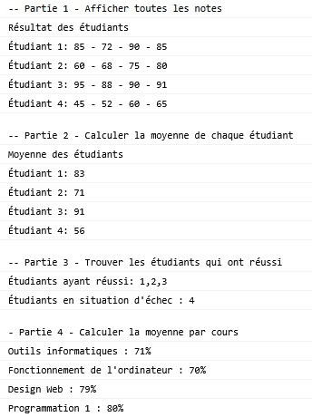

# Exercice 13 - Tableau en JavaScript

## Initialisation et remise

- Créez un dépôt nommé **dw_ex13_arrays** sur Github
- Clonez le dépôt sur votre portable et réalisez l'exercice
- Vous devez créer un fichier JavaScript qui contiendra le script et le relier à une page html.
- Une fois terminé, créez une version de votre exercice (add, commit) et poussez le (push) sur Github.
- Remettez le devoir Teams avec l'url vers votre dépot.

## Énoncé

On souhaite représenter les notes d’étudiants dans trois matières :

- Outils informatiques
- Fonctionnement de l'ordinateur
- Design Web
- Programmation 1

Crée un tableau `notes` à deux dimensions contenant les données suivantes :

```js title="Tableau de notes"
let notes = [
  [85, 72, 90, 85], // Étudiant 1
  [60, 68, 75, 80], // Étudiant 2
  [95, 88, 90, 91], // Étudiant 3
  [45, 52, 60, 65], // Étudiant 4
];
```

Chaque sous-tableau représente les notes d’un étudiant dans l’ordre : 

`[Outils informatiques, Fonctionnement de l'ordinateur, Design Web, Programmation 1]`

---

### Partie 1 - Afficher toutes les notes

- Affiche dans la console chaque note de chaque étudiant sous le format suivant: 

```text
Résultat des étudiants
Étudiant 1: 85 - 72 - 90 - 85
Étudiant 2: 60 - 68 - 75 - 80
Étudiant 3: 95 - 88 - 90 - 91
Étudiant 4: 45 - 52 - 60 - 65
```

!!! Astuce

    Utilise une boucle imbriquée (for dans un for) ou un `array.forEach()`.

---

### Partie 2 - Calculer la moyenne de chaque étudiant

- Pour chaque étudiant, calcule sa moyenne et arrondi la.
- Affiche ensuite les résultats de cette façon :

```text
Moyenne des étudiants
Étudiant 1: 83
Étudiant 2: 71
Étudiant 3: 91
Étudiant 4: 56
```

!!! Astuce

    tu peux utiliser `array.reduce()` ou simplement additionner les valeurs à l’aide d’une boucle.

    **Optionnel**

    Crée une fonction nommée `calculMoyenne` qui prend un tableau de notes en paramêtre et retourne la moyenne arrondie. Tu pourras réutiliser la fonctionne dans la partie 3.

---

### Partie 3 - Suivi de la réussite des étudiants

- Crée un tableau `reussite` et un tableau `echec`.
- Ajoute le numéro de l'étudiant dans le tableau `reussite` si ça moyenne est supérieur ou égale à 60, sinon ajoute le dans le tableau `echec`.
- Affiche ensuite le résultat de cette façon

```text
Étudiants ayant réussi : 1,2,3
Étudiants en situation d'échec : 4
```

---

### Partie 4 - Calculer la moyenne par cours

- Crée un tableau `moyenneCours` qui contiendra la moyenne pour chaque cours.
- Tu peux "hardcoder" que le premier item du tableau de note correspond au cours outils informatiques, le deuxième fonctionnement de l'ordinateur, etc.
- Vous pouvez aussi prendre pour acquis qu'il y a toujours une note pour chaque cours par élève.
- Affiche le résultat comme ceci: 

```text
Outils informatiques : 71%
Fonctionnement de l'ordinateur : 70%
Design Web : 79%
Programmation 1 : 80%
```

---

## Résultat final

Vous devriez avoir dans votre console un résultat qui resssemble à cette image: 

<figure markdown>
  {.center .shadow}
  <figcaption>Résultat final</figcaption>
</figure>