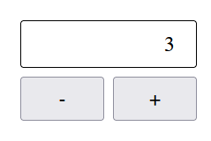
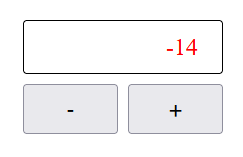
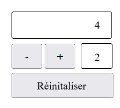

# Exercice 15 - Compteur

Cet exercice va vous permettre de mettre en pratique différentes notions de JavaScript comme les événements, les fonctions et la modification des éléments du DOM

- Vous devez recréer la disposition suivante avec une balise [`<input>`](https://developer.mozilla.org/fr/docs/Web/HTML/Reference/Elements/input){target=_blank} de type `text` et deux boutons. 
- Ajoutez aussi un attribut `id` à la balise et l'attribut `readonly`. 
- La mise en page doit être faite avec Grid.

<figure markdown>
  {.center .shadow}
  <figcaption>Disposition du compteur</figcaption>
</figure>

??? astuce "Utilisation de la balise `<input>`"

    Voici un exemple d'une balise ``<input>``: 

    ```html
    <input type="text" name="resultat" id="resultat">
    ```

- Au chargement de la page, le compteur doit afficher 0. 
- Quand on clique sur le bouton "+", on incrémente le compteur de 1. 
- À l'inverse quand on clique sur le bouton "-" on décrémente la valeur de 1.
- Pour ce faire, utilisez l'attribut `onClick` sur les balises appropriées.

??? astuce "Comment modifier la valeur d'un input"

    Dans votre script, associez une variable à la balise input en utilisant son id:

    ```js
    // La valeur "resultat" est le valeur du id que j'ai donné au input
    const INPUT_RESULTAT = document.getElementById("resultat");
    ```

    Ensuite vous pouvez récupérer ou modifier la valeur du input avec `.value`:

    ```js
    INPUT_RESULTAT.value = 1; // La valeur 1 sera affiché dans le input
    console.log(INPUT_RESULTAT.value); // 1 
    ```

- Si la valeur devient négative (est inférieure à 0), le texte du **input** deviendra rouge.
- Pour modifier la couleur, utilisez une classe css que vous allez ajouter ou enlever au input.

??? astuce "Ajouter ou enlever une classe à une élément HMTL"

    Ajouter une classe avec `element.classlist.add("nomDeLaClasse")`
    
    ```js
    INPUT_RESULTAT.classList.add("negatif");
    ```

    Supprimer une classe avec `element.classList.remove("nomDeLaClasse")`

    ```js
    INPUT_RESULTAT.classList.remove("negatif");
    ```

<figure markdown>
  {.center .shadow}
  <figcaption>Une valeur négative est en rouge</figcaption>
</figure>

Une fois que votre exercice fonctionne, remplacez les attributs onClick par l'utilisation de la fonction [`addEventListener()`](https://design-web-victo.github.io/notes_de_cours/js/js_event/#addeventlistener){target=_blank}


## Terminé?

### Option 1

- Ajoutez une deuxième balise `<input>` de type `number` qui permet d'indiquer de combien incrémenter la valeur. Par défaut, la valeur est fixée à 1. 
- Quand on clique sur les boutons + et -, on augmente ou diminue le compteur selon la valeur présente ce nouvel input. 
- Ajoutez un bouton permettant de réinitialiser les valeurs à 1 pour les deux zone de texte (inputs).

<figure markdown>
  {.center .shadow}
  <figcaption>Le bouton + augmente maintenant la valeur de +2 <br>et le bouton - diminue la valeur de -2</figcaption>
</figure>

### Option 2 (Avancé)

- Programmez l'interface de la [calculatrice](bonus/calculatrice.md) présentée dans la section Bonus pour qu'elle puisse réaliser un calcul simple de deux nombres.
- Quand on clique sur un des chiffres, il s'ajoute à ce qui à déjà été entré et on affiche le nouveau nombre sur l'écran de la calculatrice.
- Si on clique sur une des touches d'opération, l'écran s'efface et on peut entrer un autre nombre. 
- Ensuite on clique sur la touche `=` pour afficher le résultat.