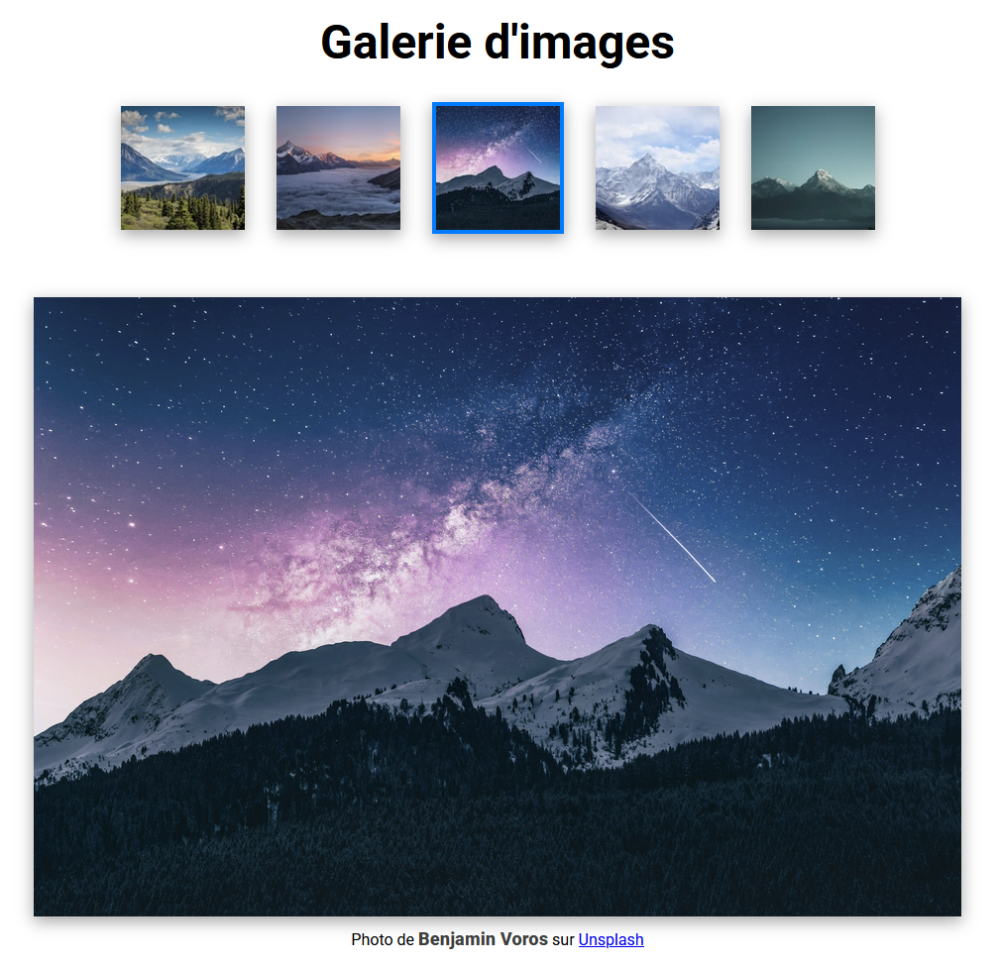

# Exercice 16 - Galerie d'images

## Initialisation et remise

- Téléchargez le projet de départ : [ex16_depart.zip](../ressources/ex16_depart.zip)
- Vous n'avez pas à faire de remise pour cet exercice

## Énoncé

Dans cet exercice vous devez ajouter un script JavaScript qui va permettre, en cliquant sur une image en vignette, d'afficher cette image dans une taille plus grande. 

<figure markdown>
  {.center .shadow}
  <figcaption></figcaption>
</figure>

- Le projet de départ contient déjà une page html et un script css fonctionnel. ==Vous ne devez pas modifier ces deux fichiers.==
- Les images proviennent du site [Unsplash](https://unsplash.com/fr){target=_blank}
- Toutes les informations nécessaire sont déjà inscrite dans la balise `` de chacune des vignettes dans des attributs:

| Attribut | Description |
|-----|-----|
| alt | Le texte alternatif à utiliser |
| data-img-full | L'url de l'image en haute résolution |
| data-auteur | Le nom de l'auteur |
| data-origin-url | Un lien vers l'image sur le site Unsplash |

```html title="exemple"

```

## Sélection de l'image

Quand on clique sur une des images de vignette, il y a deux événements qui se déroule: 

- La vignette est entourée d'un cadre bleu pour indiquer qu'elle est sélectionnée
- L'image en haute résolution est affichée plus bas

### Cadre sur la vignette

- Dans le fichier `style.css` il y a déjà une classe qui va créer le cadre bleu : `selected`.
- Quand on clique sur une vignette, ajoutez cette classe à la balise `` et assurez-vous qu'elle ne soit pas présente sur les autres vignettes.
- Une stratégie serait d'enlever la classe à toutes les vignettes et d'ensuite l'ajouter à celle qui est sélectionnée.
- Vous devez utiliser `querySelectorAll()` et la classe `image-thumbnail` pour sélectionner toutes les vignettes dans un tableau.

### Affichage de l'image en haute résolution

Modifiez les informations suivantes par les attributs de l'image de vignette.

- Dans la balise `` avec le id `image-full`:
    - L'attribut `src` correspond à l'attribut `data-img-full` de la vignette
    - L'attribut `alt` est le même que la vignette
- Dans la balise `<span>` avec le id `auteur`
    - Modifier le texte à l'intérieur de la balise avec `innerText` pour la valeur de l'attribut `data-auteur` dela vignette
- Dans la balise `<a>` avec le id `lien-source`
    - L'attribut `href` correspond à l'attribut `data-origin-url` de la vignette

Utilisez la méthode que vous souhaitez pour sélectionner les différentes balises.

