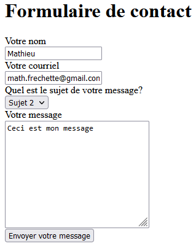
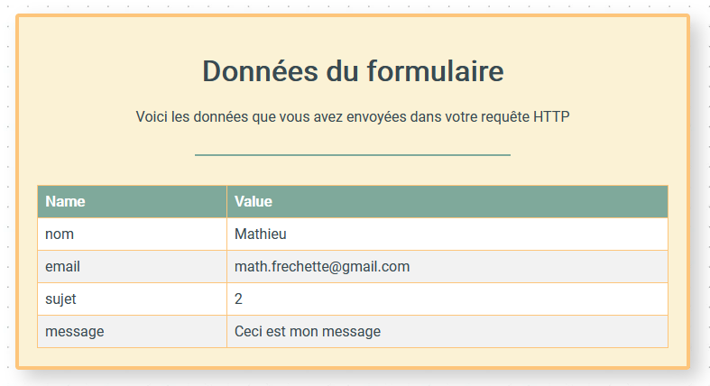
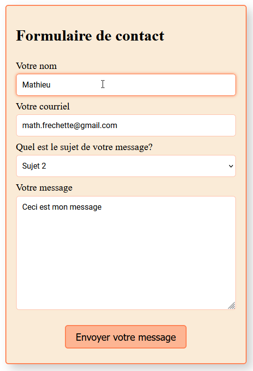
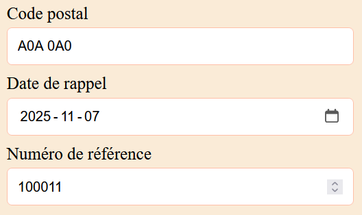

# Exercice 18 - Formulaire de contact

Dans cet exercice nous allons créer un formulaire simple de contact.

- Il n'y a ==aucune validation à faire== dans la première partie
- Le formulaire va uniquement envoyer les informations vers une adresse en ligne.
- Aucun code javascript n'est nécessaire pour réaliser cet exercice

## Création du formulaire

- Créez un nouveau site internet avec une page html et un fichier de style.
- Dans cette page vous allez créer un formulaire avec les éléments de saisie décrit plus bas.

### Description des éléments de saisie

- Chaque élément de saisie ==doit être accompagné== d'une balise **label** et avoir un attribut **name**.
- Ajoutez une balise **input** pour saisir le nom.
- Ajoutez une balise **input** pour saisir le courriel. Donnez le type **email** à cette balise.
- Ajoutez une **liste déroulante** avec au moins 4 choix. Le texte du label sera "Quel est le sujet de votre message?".
- Ajoutez une balise **textarea** avec une taille de base de 30 colonnes et 10 lignes.
- Ajoutez un bouton qui soumettra le formulaire. 

### Propriété du formulaire

- Le formulaire doit envoyer les données par la méthode **POST**
- Les données sont envoyé à l'adresse suivante : 
```
https://design-web.onrender.com/submit
```

- Assurez vous que les valeurs des 4 champs sont bien envoyées. Quand vous soumettrez votre formulaire, une page devrait afficher vos données dans un tableau.

<figure markdown>
  {.center .shadow}
  <figcaption>Votre formulaire</figcaption>
</figure>

<figure markdown>
  {.center .shadow}
  <figcaption>La confirmation une fois envoyé</figcaption>
</figure>

## Mise en forme du formulaire

- Modifier le padding et la taille de la police de chacun des éléments de saisie.
- Quand les balises **input**, **textarea** et **select** on le focus, changez la couleur de la bordure.
- Modifier le style du bouton pour le rendre plus attrayant et centrez le dans le formulaire.
- Ajoutez aussi un effet de survol sur le bouton.
- Amusez vous à styliser le formulaire à votre guise.

<figure markdown>
  {.center .shadow}
  <figcaption>Exemple de résultat</figcaption>
</figure>

## Validation HTML

Nous allons maintenant ajouter des attributs de validation au formulaire simple de contact fait à l'exercice précédent.

### Modifications à apporter au formulaire

- Ajoutez l'option "Sélectionnez un sujet" et attribuez un valeur vide (`value=""`) dans la liste déroulante *"Quel est le sujet de votre message?"*.
- Entre le `<textarea>` et le bouton "Envoyer votre message" ajoutez les trois `<input>` suivant: 
    - Ajoutez le champ "code postal" de type **text**.
    - Ajoutez le champ "date de rappel" de type **date**.
    - Ajoutez le champ "numéro de référence" de type **number**.

<figure markdown>
  {.center .shadow}
  <figcaption></figcaption>
</figure>

### Validation du formulaire

- Utilisez les attributs HTML appropriés afin d'ajouter des validations HTML à votre formulaire.
  - Tous les champs sont requis à l'exception du code postal et du numéro de référence.
    - Si l'utilisateur soumet le formulaire sans saisir les informations, le formulaire ne doit pas être soumis et un message doit indiquer les informations omises.
    - L'option "Sélectionnez un sujet" est considérée ==comme une information omise==.
  - Le nom doit être d'au moins 2 caractères et d'au plus 100 caractères.
  - Le format du courriel saisi doit être valide. Prenez le temps de consulter ces deux liens et utilisez la méthode qui vous semble la plus pertinente : 
    - [https://html5-tutorial.net/form-validation/validating-email/](https://html5-tutorial.net/form-validation/validating-email/){target=_blank}
    - [Discussion sur r/webdev](https://www.reddit.com/r/webdev/comments/yokmla/hmtl_email_input_validation_is_really_bad_and/){target=_blank}
  - Le message doit être d'au plus 500 caractères.
  - La date de rappel doit être supérieure au 2023-11-13.
  - Le numéro de référence doit être une valeur numérique entre 100001 et 199999
  - Le code postal doit avoir exactement 7 caractères et correspondre au format A0A 0A0. Faîtes une recherche Internet pour trouver le bon "pattern".


