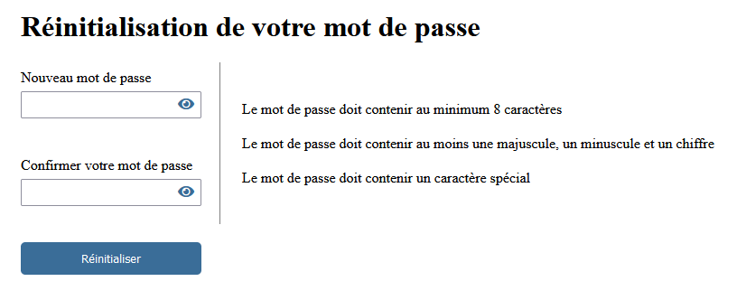
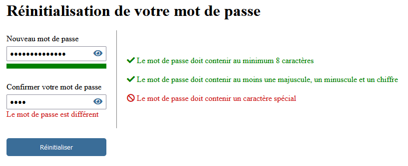
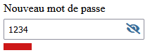
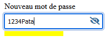
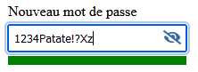
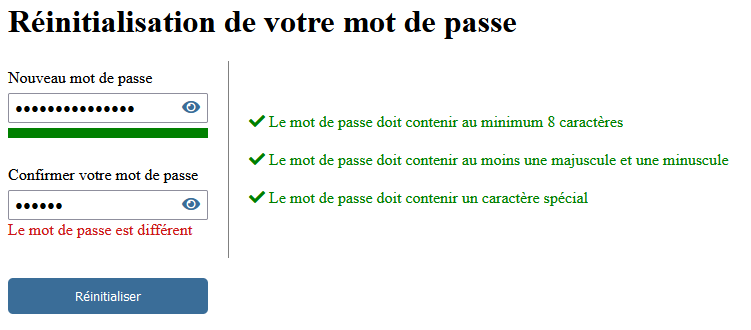

# Exercice 19 - Formulaire de réinitialisation de mot de passe

Dans cet exercice, on va créer un formulaire de réinitialisation de mot de passe. L'usager va être invité à choisir un nouveau mot de passe qui correspond à un format qu'on va lui indiquer. Ensuite, il devra le saisir à nouveau pour le confirmer et finalement cliquer sur un bouton réinitialisation. 

Téléchargez le projet de base ici : [ex19_password_depart.zip](../ressources/ex19_password_depart.zip){target=_blank}

<figure markdown>
  {.center .shadow}
  <figcaption>Version finale de l'interface au chargement</figcaption>
</figure>

<figure markdown>
  {.center .shadow}
  <figcaption>Version avec les validations</figcaption>
</figure>


## L'interface

Essayez de reproduire de votre mieux l'interface que je vous présente.

- Sous le **input** du nouveau mot de passe, il y a une barre de couleur qui affiche la force du mot de passe. (Voir plus bas pour plus de détail)
- Dans la section où il y a trois phrases qui renseignent sur le format demandé, c'est une icône de Font Awesome qui est placé au-devant de la phrase. Aucune icône lors du chargement de la page, **fas fa-check** quand c'est valide et **fas fa-ban** quand ça ne l'est pas.

```html title="exemple d'utilisation"
<i class="fas fa-check"></i> Le mot de passe doit contenir au minimum 8 caractères
<i class="fas fa-check"></i> Le mot de passe doit contenir au moins une majuscule et une minuscule
<i class="fas fa-ban"></i> Le mot de passe doit contenir un caractère spécial
```

- Utilisez une balise `<form>` pour englober le formulaire. 
- La valeur de l'attribut action est `#`.
- Interceptez l'événement `submit` en JavaScript lors d'un clique sur le bouton réinitialiser. Les informations sur la validation à faire sont plus basses.

!!! Astuce

    Si votre navigateur n'affiche pas d'icone pour afficher en clair le mot de passe (Firefox entre autre) vous pouvez le programmer vous-même.
    Voici une technique : [Créer un bouton qui affiche le mot de passe](../notes/how_password_reveal.md){target=_blank}

## La validation

### Le nouveau mot de passe

La validation se fera dès qu'un changement est fait dans la zone de saisie du nouveau mot de passe, utilisez l'événement **input**. Pour les validations à faire lors de la saisie : 

- Le texte doit contenir au minimum 8 caractères.
- Le mot de passe doit contenir au moins une majuscule et une minuscule.
- Le mot de passe doit contenir un caractère spécial. Pour cette validation vous pouvez utiliser l'expression régulière suivante :

```javascript
const caractereSpecial_regex = /[!@#$%^&*(),.?":{}|<>]/;
```

!!! Astuce

    Vous pouvez facilement tester si un texte correspond aux exigences d'une expression régulière avec la fonction `test()`. La fonction prend le texte en paramètre et retourne True ou False selon le résultat.
    Pour plus de détail : [https://developer.mozilla.org/en-US/docs/Web/JavaScript/Reference/Global_Objects/RegExp/test](https://developer.mozilla.org/en-US/docs/Web/JavaScript/Reference/Global_Objects/RegExp/test){target=_blank}

Pour les trois validations, affichez l'icône correspondant et la bonne couleur si c'est vrai ou faux.

Vous devez aussi afficher une barre de couleur selon la force du mot de passe. Pour connaître sa force, je vous ai fourni dans le template de base une librairie appelée **zxcvbn**. Vous pouvez l'utiliser comme ceci dans votre script JS : 

```javascript linenums="1"
const resultatForce = zxcvbn("mon_mot_de_passe");
// resultatForce.score va retourner une valeur de 0 (faible) à 4 (fort)
console.log(resultatForce.score); 
```

La barre va être divisée en 5 sections. Le nombre de sections colorées correspond au score +1 (1 section colorée pour un score de 0 et toutes les sections pour un score de 4). La couleur des sections va aussi changer selon le score : 

<figure markdown>
  {.center .shadow}
  <figcaption>< 2 : rouge</figcaption>
</figure>

<figure markdown>
  {.center .shadow}
  <figcaption>== 2 : jaune</figcaption>
</figure>

<figure markdown>
  {.center .shadow}
  <figcaption> > 2 : vert</figcaption>
</figure>


Pour la barre à vous de voir comment la faire. J'ai utilisé 5 **div** côte à côte disposées en Flex avec une hauteur et une largeur fixe. Je change ensuite la couleur de fond des **divs** qui doivent être affichées.

### Le bouton Réinitialiser

Quand on clique sur le bouton "Réinitialiser", on doit empêcher l'envoi du formulaire ==si les validations ne sont pas respectées==: 

- Les trois qu'on fait lors de la modification du texte (8 caractères, majuscule, minuscule et caractère spécial)
- Le score du mot de passe doit être de force de 3 au minimum. 

Le mot de passe inscrit dans le **input** "Confirmer votre mot de passe" doit aussi correspondre. S'il est différent, affichez un message d'erreur sous celui-ci.

{.center .shadow}