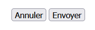
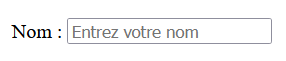
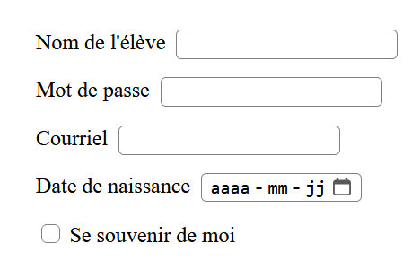
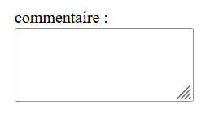
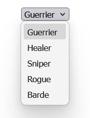
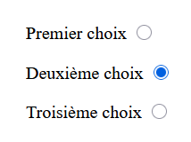
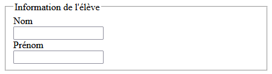

# Les éléments de saisies de données

Il existe plusieurs éléments HTML qu'on peut utiliser pour saisir les données de l'utilisateur : input, textarea, select, etc... L'important à se rappeler est que peut importe l'élément utilisé, on doit ==toujours lui définir l'attribut **name**== avec une valeur unique au formulaire, sinon les informations ne seront pas transmises au serveur.

## L'élément button

Pour permettre à l'usager de soumettre son formulaire, l'usage le plus courant est d'ajouter un bouton à la toute fin de notre formulaire, juste avant la fermeture de la balise form. Le bouton a un attribut **type** qu'on va utiliser pour définir son comportement dans le formulaire : 

- `submit` : En cliquant sur un bouton avec le type submit, les données du formulaire seront envoyées vers la page définie par l'attribut action de l'élément form.
- `reset` : Tous les contrôles du formulaire seront réinitialisés à leur valeur par défaut.
- `button` : À utiliser pour créer un bouton régulier.

```html
<button type="reset">Annuler</button>
<button type="submit">Envoyer</button>
```

<figure markdown>
  {.center .shadow}
  <figcaption></figcaption>
</figure>

## L'élément label

L'élément label n'est pas essentiel mais c'est une bonne pratique de toujours l'associé à chacun de nos éléments de saisie. 

- Le label est utilisé par les options d'accessibilité comme les lecteurs d'écran.
- En cliquant sur le label, on donne le focus à l'élément qui lui est lié.

Pour relier un label à un élément, on utilise la balise **for** qui doit correspondre à la valeur de la balise **id** de l'élément à lier. 

``````html
<!-- La valeur nom est utilié pour l'attribut for du label et id du input, les 
     deux éléments sont ainsi liés -->
<label for="nom">Nom :</label>
<input type="text" id="nom" name="nom_usager" placeholder="Entrez votre nom">
``````

<figure markdown>
  {.center .shadow}
  <figcaption></figcaption>
</figure>

## L'élément input

L'élément input est le plus utilisé dans la création de formulaire, il peut prendre plusieurs formes grâce à son attribut **type**. Voici un lien qui dresse une liste complète des différentes valeurs que peut prendre type : [https://developer.mozilla.org/fr/docs/Web/HTML/Element/Input](https://developer.mozilla.org/fr/docs/Web/HTML/Element/Input){target=_blank}. Parmi les plus utilisés on retrouve le type **text**, **password**, **date**, **email** et **checkbox**.

``````html
<label for="text-eleve">Nom de l'élève</label>
<input type="text" name="nom-eleve" id="text-eleve">    

<label for="mot-passe">Mot de passe</label>
<input type="password" name="password" id="mot-passe">    

<label for="courriel-eleve">Courriel</label>
<input type="email" name="courriel-eleve" id="courriel-eleve">    

<label for="date-naissance">Date de naissance</label>
<input type="date" name="date-naissance" id="date-naissance">  

<input type="checkbox" name="check-souvenir" id="check-souvenir">
<label for="check-souvenir">Se souvenir de moi</label>
``````

<figure markdown>
  {.center .shadow}
  <figcaption></figcaption>
</figure>

## L'élément textarea

Un textarea est un élément qui nous permet de saisir du texte sur plusieurs lignes. Une particularité de cet élément est qu'au contraire de la balise input, ou doit ajouter une fermeture de la balise.

``````html
<!-- input ne demande pas de fermeture de balise -->
<label for="nom">Nom :</label>
<input type="text" id="nom" name="nom_usager">
<!-- textarea en requiert une -->
<label for="message">Message :</label>
<textarea id="message" name="message"></textarea>
``````

<figure markdown>
  {.center .shadow}
  <figcaption></figcaption>
</figure>

## L'élément select

Select permet d'afficher une liste déroulante de choix prédéfinis. Pour ajouter les options de la liste, on utilise la balise **option**. La valeur qui sera envoyé dans le formulaire est celle qui est inscrite dans l'attribut `value` de l'option choisi. Dans l'exemple suivant si on choisit l'option "Barde", la valeur envoyée sera 5. Si aucune **value** n'est spécifié, la valeur entre la balise **option** sera utilisé.

``````html
<select name="classe_perso" id="classe_perso">
  <option value="1">Guerrier</option>
  <option value="2">Healer</option>
  <option value="3">Sniper</option>
  <option value="4">Rogue</option>
  <option value="5">Barde</option>
</select> 
``````

<figure markdown>
  {.center .shadow}
  <figcaption></figcaption>
</figure>

### Récupérer la valeur sélectionnée

```JavaScript
const selectClasse = document.getElementById('classe_perso');
console.log(selectClasse.value); // 1
console.log(selectClasse.options[selectClasse.selectedIndex].text); // Guerrier
```

## L'élément radio

L'élément radio est un type spécial de la balise input qui affiche un choix sous forme de cercle selectionnable. On peut regrouper plusieurs élément radio ensemble en leur donnant la même valeur à l'attribut **name**. Dans ce cas on ne pourra que sélectionner qu'un élément du groupe à la fois. On doit utiliser l'attribut **value** à chaque input pour indiquer quelle valeur sera transmis avec le formulaire. 

L'élément de type radio ne représente que le cercle qu'on peut sélectionner, si on veut lui joindre un texte descriptif on utilisera une balise **label**. 

Finalement on peut utiliser l'attribut **checked** pour indiquer quel input sera sélectionné au chargemenent de la page. *Pour que ça fonctionne avec Firefox on doit aussi ajouter l'attribut autocomplete="off" à chaque input.*

``````html
<!-- Pour plus de lisibilité j'ai inscrit mes attributs sur plusieurs lignes -->
<label for='choix1'>Premier choix</label>
<input type='radio' 
      id='choix1' 
      name='choix_radio' 
      value="choix1" 
      autocomplete="off">

<label for='choix2'>Deuxième choix</label>
<input type='radio' 
      id='choix2' 
      name='choix_radio' 
      value="choix2" 
      autocomplete="off"
      checked>

<label for='choix3'>Troisième choix</label>
<input type='radio' 
      id='choix3' 
      name='choix_radio' 
      value="choix3" 
      autocomplete="off">
``````

<figure markdown>
  {.center .shadow}
  <figcaption></figcaption>
</figure>

### Récupérer la valeur sélectionnée

On peut tester si le choix est sélectionné ou non avec la propriété `.checked` qui retourne un booléen : 

```js
const choix1 = document.getElementById("choix1");
if (choix1.checked) {
  console.log("Vous avez choisi le premier choix.");
}
```

On peut aussi récupérer la valeur de l'attribut avec la propriété `.value` comme pour un autre controle de formulaire : 

```js
const choix1 = document.getElementById("choix1");
if (choix1.checked) {
  console.log(`La valeur est sélectionné est : ${choix1.value}`);
}
```

Pour retrouver le choix qui est sélectionné dans le groupe on peut faire une boucle sur tous les choix en utilisant `.getElementsByName()` qui retourne un tableau. Avec l'exemple plus haut ça donnerait : 

```js
const radioButtons = document.getElementsByName('choix_radio');
let valeurSelectionnee = '';

for (let i = 0; i < radioButtons.length; i++) {
  if (radioButtons[i].checked) {
    valeurSelectionnee = radioButtons[i].value;
  }
}

console.log(`La valeur est sélectionné est : ${valeurSelectionnee}`)
```

On peut faire plus court avec `.querySelector()` et un sélecteur css qui utilise la pseudo-classe `:checked` : 

```js
const checkedRadioButton = document.querySelector('input[name="choix_radio"]:checked');

// La condition ici est une sureté supplémentaire pour s'assurer que le choix est bien coché
if (checkedRadioButton) {
  console.log(`La valeur est sélectionné est : ${checkedRadioButton.value}`)
}
```


## L'élément fieldset
Avec cet élément on peut regrouper ensemble plusieurs autres éléments. Une bordure sera affiché par défaut autour de ces éléments On peut aussi ajouter la balise **legend** à l'intérieur d'un **fieldset** pour donner un titre à notre "regroupement".

``````html
<fieldset>
	<legend>Information de l'élève</legend>

	<label for="nom-eleve">Nom</label>
	<input type="text" name="nom-eleve" id="nom-eleve">

	<label for="prenom-eleve">Prénom</label>
	<input type="text" name="prenom-eleve" id="prenom-eleve">

</fieldset>
``````
Résultat

{.center .shadow}