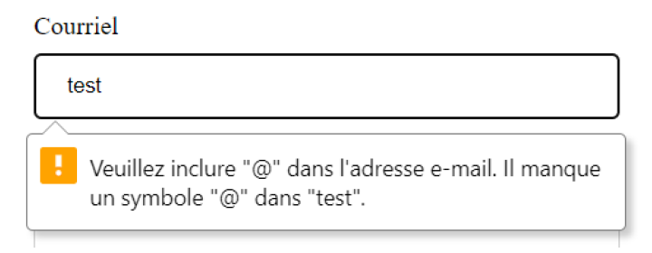
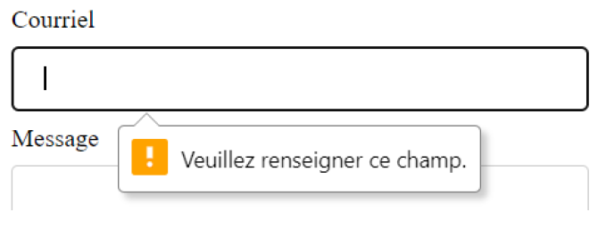

# Validation de formulaire en HTML

On peut en HTML uniquement implémenter une première "couche" de validation en utilisant certain attributs spécifiques. Il faut garder à l'esprit que cette validation est basique et ne devrait pas être utilisé seule.

## L'attribut type

Il existe maintenant pour l'attribut **type** de l'élément input une multitude de valeur possible qui permet de spécifier le type de valeur souhaité et en même temps de faire une validation.

``````html
<!-- Input qui demande une adresse de courriel -->
<input type="email" id="email" name="email_usager" placeholder="Entrez une adresse courriel valide">
``````

Résultat lors de l'envoi du formulaire, le message d'erreur varie d'un navigateur à l'autre.



## L'attribut required

Indique qu'une valeur doit être saisie pour l'élément avant l'envoi du formulaire. Selon le navigateur utilisé un message d'erreur sera affiché.

``````html
<label for="email">e-mail</label>
<input type="email" id="email" name="email_usager" required>
``````

Résultat lors de l'envoi du formulaire



## L'attribut pattern

On peut avec l'attribut pattern définir notre propre format de texte accepté. Pattern prend comme valeur une expression régulière. Il est très important d'informer l'utilisateur du format à respecter, soit avec la balise **title** ou en ajoutant un court texte explicatif.

``````html
<label for="ipv4">Courriel</label>
<input type="text" id="ipv4" name="ipv4" pattern="\d{1,3}\.\d{1,3}\.\d{1,3}\.\d{1,3}" required title="Adresse IPv4">
<p>Veuillez entrer une adresse IPv4 au format xxx.xxx.xxx.xxx</p>
``````

Pour vous aider avec les regex : [https://regexr.com/](https://regexr.com/)

## Les attributs minlength et maxlength

On peut utiliser pour une balise input de type **text** les attributs minlength et maxlength pour déterminer une nombre minimum et maximum de caractères

``````html
<input type='text' id='adresse' name='adresse' maxlength="50">
``````

## Les attributs min et max

Ces attributs permettent de déterminer une borne inférieur et supérieur à une balise `<input>` où l'on saisie une valeur numérique ou une date.

```html
<label for='date_rencontre'>Date de rappel</label>
<input type='date' id='date_rencontre' name='date_rencontre' min="2025-11-11">

<label for='quantite'>Numéro de référence</label>
<input type='number' id='quantite' name='quantite' min="0" max="100">
```


