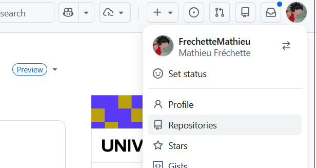
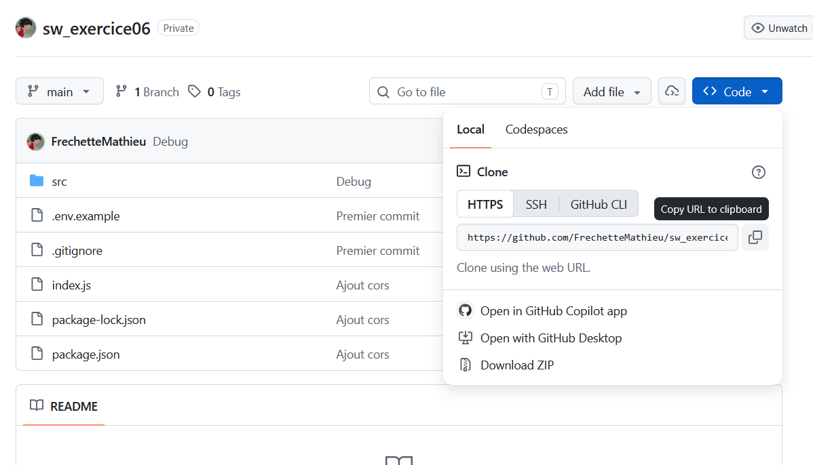

# GitHub

Il est tout à fait possible d'utiliser uniquement Git pour faire une gestion locale des versions de ses projets de développement. Cependant, il peut être intéressant de partager son code sur une plateforme collaborative. Il existe plusieurs plateformes intégrant Git, les 2 plus connues étant GitHub (utilisée principalement pour le partage de projets publics) et Bitbucket (utilisée principalement pour la collaboration de projets privés). Dans le cadre du cours, nous utiliserons GitHub. 

## Différences entre Git et GitHub

- Git est un outil permettant aux développeurs de gérer le cycle de vie de leurs projets.
- GitHub est une plateforme web intégrant les fonctionnalités Git permettant de collaborer sur des projets de développement.

## Créer un dépôt

Pour créer un nouveau dépôt, connectez-vous à votre compte sur le site GitHub et 
sélectionnez **Repositories** dans le menu accessible en cliquant sur votre image 
de profil en haut à droite.  

{.center .shadow}

Cliquez ensuite sur le bouton  **New** qui se situe en haut à droite. 

{.center .shadow}

Remplissez les informations requises

- Nom du dépôt: à votre discrétion, mais doit être différent des autres dépôts qui sont associés à votre 
utilisateur ou une organisation.
- Visibilité: **Public** si vous voulez utiliser GitHub Pages, sinon **privé**
- Cochez **Add a README file**

Cliquez sur "Create repository"

## Cloner un dépôt distant

Vous avez un dépôt en ligne et vous voulez en avoir une copie sur votre portable pour pour y travailler. 

Dans la page de votre dépôt, cliquez sur le bouton **<> Code** et copiez l'url du dépôt.

{.center .shadow}

Ensuite ouvrez une console et faites la commande suivant. Un répertoire du nom du dépôt sera créé et les fichiers y seront téléchargés.

```
git clone [url]
```
## Lier un dépôt local à un dépôt Github

Ouvrez une console dans le répertoire de votre dépôt local et entrez la commande suivante en remplaçant l'url par celui du dépôt sur GitHub : 

```bash
git remote add origin [url du dépôt]
```