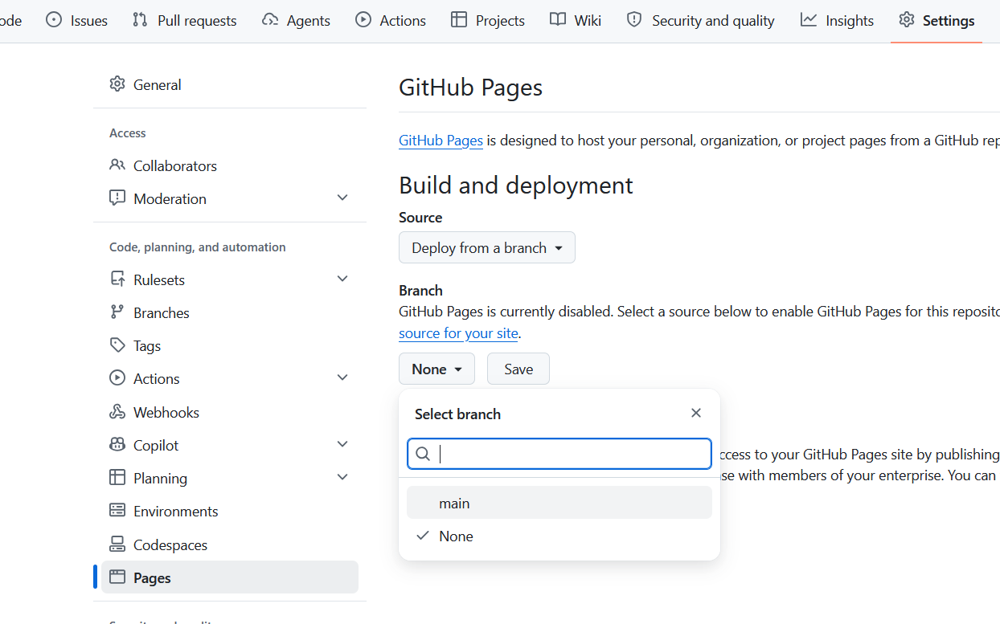
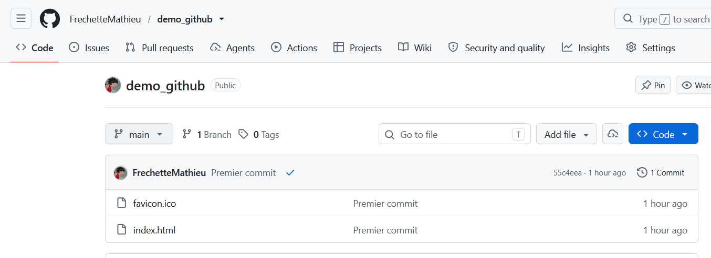

# Héberger un site sur GitHub Pages

GitHub Pages est un service d'hébergement offert gratuitement par Github.

1. [Créer le dépôt sur GitHub](github.md#creer-un-depot){target=_blank} 
1. [Récupérer le dépôt sur votre ordinateur](github.md#cloner-un-depot-distant){target=_blank}
1. Créer votre site dans le dossier du dépôt
1. [Envoyer le code sur GitHub](cheatsheet.md#effectuer-des-changements){target=_blank}
1. [Configurer Github Pages pour votre dépôt](#configurer-github-pages-pour-un-depot)
1. [Accéder à votre site](#acceder-a-mon-site)
1. [Mettre à jour aux besoins](cheatsheet.md#effectuer-des-changements){target=_blank}

## Configurer Github Pages pour un dépôt

Depuis la page de votre dépôt: 

- Cliquez sur **Settings** dans le menu en haut de la page
- Dans le menu de gauche allez dans la section **Pages**
- Choisissez la branche de votre dépôt que vous voulez utiliser. Dans le cours nous ne voyons pas les branches alors vous ne devriez avoir que **main**
- Cliquez ensuite sur **Save**

<figure markdown>
  {.center .shadow}
</figure>

## Accéder à mon site

L'url de votre site est le suivant `https://[nom utilisateur].github.io/[nom du dépôt]/`

- `[nom utilisateur]` = Votre nom d'utilisateur Github
- `[nom du dépôt]` = Le nom du dépôt

<figure markdown>
  {.center .shadow}
  <figcaption></figcaption>
</figure>

Dans cette exemple l'url serait ==https://**frechettemathieu**.github.io/**demo_github**/==

!!! Astuce

    Si vous nommez votre dépôt `[nom utilisateur].github.io`, vous pourrez utiliser uniquement l'url `https://[nom utilisateur].github.io`

