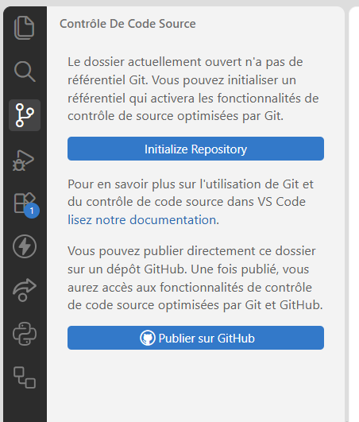
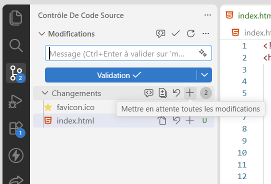
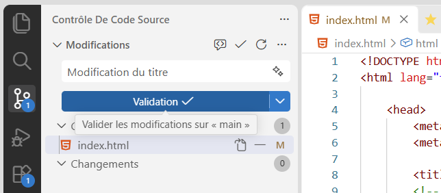
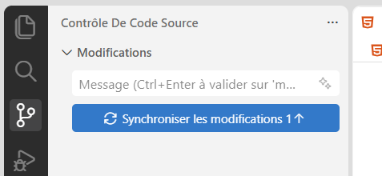
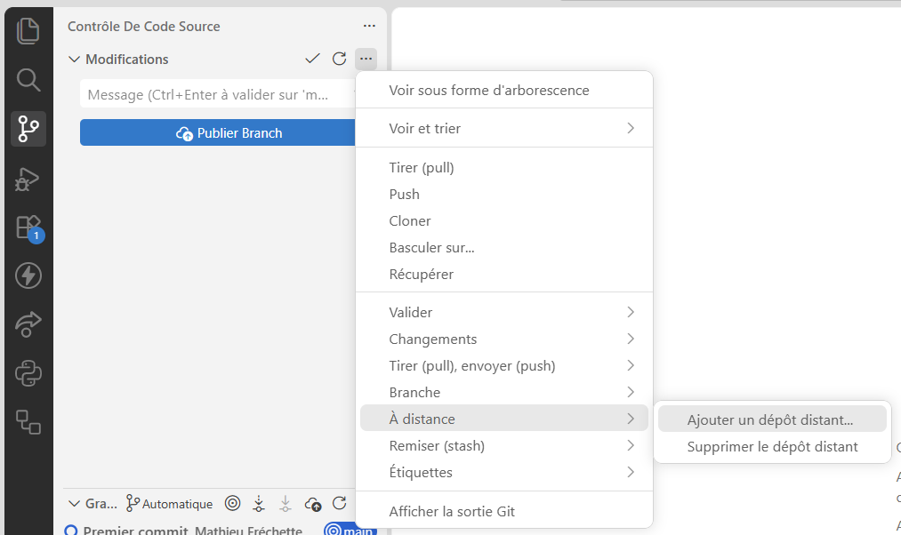
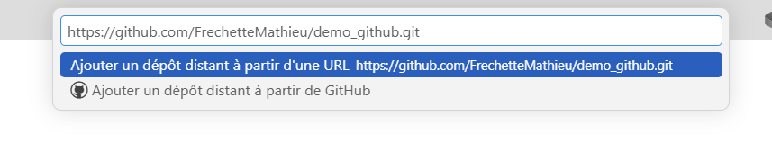

# Utiliser git dans VS Code

Il y a une interface déjà incluse dans VS Code pour vous permettre de gérer vos projets avec git. 

Dans le menu latéral de gauche, cliquez sur le troisième item : "Contrôle de code source".

## Initialiser un dépôt (git init)

Si votre projet n'a pas encore de dépôt git, vous aurez accès à cette interface. 
Juste à cliquer sur le bouton **Initialyze Repository** pour créer un dépôt dans votre répertoire de projet.

<figure markdown>
  {.center .shadow}
  <figcaption></figcaption>
</figure>

## Ajouter les modifications dans la file d'attente (git add)

Cliquez sur l'icone **+** de la ligne **Changements** (remplace la commande `git add .`) 
ou sélectionnez les fichiers à ajouter un par un en cliquant sur leur nom.

<figure markdown>
  {.center .shadow}
  <figcaption></figcaption>
</figure>

## Créer une version (git commit)

Inscrivez le texte de description de votre commit et cliquez sur le bouton **Validation**

<figure markdown>
  {.center .shadow}
</figure>

## Publier le commit sur un dépôt distant (git push)

Si votre dépôt est déjà lié à un dépôt distant, vous n'avez qu'à cliquer sur le bouton **Synchroniser les modifications**

<figure markdown>
  {.center .shadow}
</figure>

## Lier le dépôt local à un dépôt distant (git remote add origin)

Si votre dépôt local n'est pas encore lié: 

- Cliquez sur l'icone **...** de la ligne modification
- Sélectionnez **À distance**
- Cliquez sur **Ajouter un dépôt distant...**

<figure markdown>
  {.center .shadow}
</figure>

Ensuite copiez l'url du dépôt distant dans l'invite.

<figure markdown>
  {.center .shadow}
</figure>

Vous pouvez aussi choisir l'option **Ajouter un dépôt distant à partir de Github** et le choisir dans la liste proposée.

