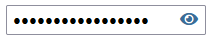
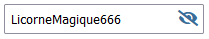

# Créer un bouton qui affiche le mot de passe

Dans les zones de saisie de mot de passe on voit souvent un bouton ou icone qui nous permet de voir le mot de passe "en clair". C'est quand même facile à implémenter. On a vu qu'en utilisant l'attribut **type="password"** dans une balise input, ça masque les caractères qu'on entre. Notre bouton va changer la valeur de cet attribut de **password** pour masquer le texte à **text** pour l'afficher.

## Le contrôle avec le bouton

On va créer le contrôle suivant à l'aide d'une balise input et d'un icone de font Awesome:

<figure markdown>
  {.center .shadow}
</figure>

<figure markdown>
  {.center .shadow}
</figure>

### HTML

En html on va ajouter une balise input avec par défaut l'attribut **type='password'**. On va ensuite ajouter l'icone qu'on veut utiliser. Pour cet exemple j'ai utilisé une icone de [Font Awesome](https://fontawesome.com/search){target=_blank}.

``````html
<input type='password' id='password' name='password'>
<i class="fas fa-eye icone-reveal"></i>
``````

### CSS

En css on va positionner l'icone au-dessus du **input** en jouant avec la marge de gauche. On a vu que la marge représente l'espace entre un élément et son voisin. Si on applique une marge négative, l'élément va se rapprocher au lieu de s'éloigner. En ayant une valeur assez petite, l'élément va finir par s'afficher par-dessus son voisin. On n'a pas besoin d'utiliser d'autres propriétés, c'est de la magie css. Pour que ça soit plus "propre" on va aussi ajouter un padding à droite à notre **input** pour ne pas que le texte qu'on y entre soit en-dessous de l'icone.

``````css
.icone-reveal {
    margin-left: -30px;
    cursor: pointer;
    color: rgb(58, 109, 152);
}

#password {
    padding-right: 30px;
}
``````

## Le code Javascript

Maintenant en javascript on va écouter l'événement **click** de l'icone et changer le type du **input** et la classe du bouton quand il est détecté.

``````js
const iconeReveal = document.querySelector('.icone-reveal');

iconeReveal.addEventListener('click', (e) => {
    let icone = e.target;
    let inputPassword = document.querySelector('#input_password');
    // Modifie l'icone
    icone.classList.toggle('fa-eye');
    icone.classList.toggle('fa-eye-slash');
    // Modifie le type du input, si c'est text on le met à password et vice versa
    let nouveauType = inputPassword.getAttribute('type') == "text" ? "password" : "text";

    inputPassword.setAttribute('type', nouveauType);

});
``````
