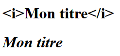

# Manipuler les attributs HTML en Javascript

On se rappelle qu'un élément HTML peu avoir des attributs, comme par exemple les attributs id, src et alt de la balise image suivante : 

``````html

``````

On peut en Javascript accéder à ces attributs et les manipuler grâce à diverses méthodes.

- `element.hasAttribute("nomAttribut")` : Vérifier si l'attribut existe
- `element.getAttribute("nomAttribut")` : Récupérer la valeur de l'attribut
- `element.setAttribute("nomAttribut", "saValeur")` : Ajouter ou modifier la valeur d'un attribut
- `element.removeAttribute("nomAttribut")` : Supprimer un attribut

Prenons par exemple un div avec seulement un attribut id

``````html title="html"
<div id="demo"></div>
``````

``````javascript linenums="1" title="JavaScript"
// Je récupère la div dans une variable
let divDemo = document.getElementById("demo");

console.log(divDemo.hasAttribute('id')); // true
console.log(divDemo.hasAttribute('title')); // false

console.log(divDemo.getAttribute('id')); // demo
console.log(divDemo.getAttribute('title')); // null

console.log(divDemo.setAttribute('title', 'Ma div principale'));
console.log(divDemo.getAttribute('title')); // Ma div principale

console.log(divDemo.removeAttribute('title'));
console.log(divDemo.getAttribute('title')); // null
``````

## Ajouter ou supprimer une classe

Pour travailler avec les classes d'un élément on va plutôt utiliser la propriété `classList`. Cette propriété contient plusieurs méthodes qu'on peut utiliser pour modifier les classes : 

```javascript title="Exemple d'utilisation de classList" linenums="1"
// Je récupère la div dans une variable
let divDemo = document.getElementById("demo");

// Ajoute la classe nouvelleClasse
divDemo.classList.add("nouvelleClasse");

// Supprime la classe ancienneClasse
divDemo.classList.remove("ancienneClasse");

// Ajout la classe visible si elle n'est pas déjà présente, sinon la supprime
divDemo.classList.toggle("visible");

// Remplace la classe rouge par bleu
divDemo.classList.replace("rouge", "bleu");

// Teste si la classe patate existe, retourne true ou false
console.log(divDemo.classList.contains("patate"));
```

## Les attributs data

On peut créer nos propre attribut dans une balise html et les utiliser entre autre pour stocker des informations reliées à la balise. Par convention le nom de l'attribut commencera par **data-** suivi du nom que vous voulez utiliser. Ensuite on peut y accéder en JavaScript de la même manière que les autres attributs.

``````html title="html"
<!-- Ón ajoute l'attribut data-key à la div et lui donne la valeur 65 -->
<div data-key="65" class="note">
	...
</div>
``````

``````js title="JavaScript"
// Sélection du premier élément avec la classe note
let note = document.querySelector('.note');
// Récupération de la valeur de l'attribut data-key de cet élément
console.log(note.getAttribute('data-key')); // 65
``````

## Modifier le texte à l'intérieur d'un élément

On peut modifier le texte qui se retrouve à l'intérieur de la balise de l'élément avec les méthodes `.innerText()` ou `.innerHTML()`. La différence est qu'avec `.innerHTML()` si l'on entre une balise HTML sous forme de texte elle sera interprétée par le navigateur. C'est une méthode pour ajouter un élément HTML sans passer par la méthode `.createElement()`.

```js title="innerText() vs innerHTML()"
const titreInnerText = document.getElementById('titreInnerText');
const titreInnerHTML = document.getElementById('titreInnerHTML');

titreInnerText.innerText = "<i>Mon titre</i>"; 
titreInnerHTML.innerHTML = "<i>Mon titre</i>";
```

<figure markdown>
  {.center .shadow}
  <figcaption>Résultat de l'extrait de code</figcaption>
</figure>


