# Déboguer nos scripts

Plus nos scripts commence à prendre de l'ampleur et de la complexité, plus il devient important de savoir bien les déboguer et trouver les erreurs. Bien que Javascript ne soit pas le langage le plus facile à déboguer, il y a quand même plusieurs méthodes à notre disposition pour trouver où et comment nos scripts "coincent".

Tous les navigateurs modernes disposent d'outils pour développeur, on y accède avec la touche F12 pour les navigateurs Firefox, Chrome et Edge. Les captures d'écran qui suivent ont été prise avec Firefox mais c'est sensiblement la même chose pour les autres navigateurs. Les deux onglets qui nous intéresse sont la **Console** et le **Débogueur**.

## Utilisation de la console

### Lecture des messages d'erreurs

La première chose à faire quand on soupçonne qu'il y a un problème avec notre script est d'ouvrir la console et de vérifier s'il y a des erreurs d'affichées. Voici un exemple d'une erreur qui s'affiche au chargement d'une page.

<figure markdown>
  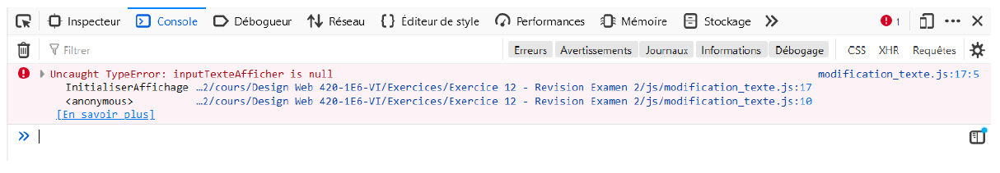{.center .shadow}
  <figcaption><a href="../../images/js_degub_01.png" target="_blank">Taille réelle</a></figcaption>
</figure>

On peut voir le message qui indique qu'il y a un problème avec "inputTexteAfficher" qui est null. On nous renseigne aussi que le problème provient de la ligne 17 du fichier modification_texte.js. Si je vais voir dans le code j'ai ceci à la ligne 17 : 

<figure markdown>
  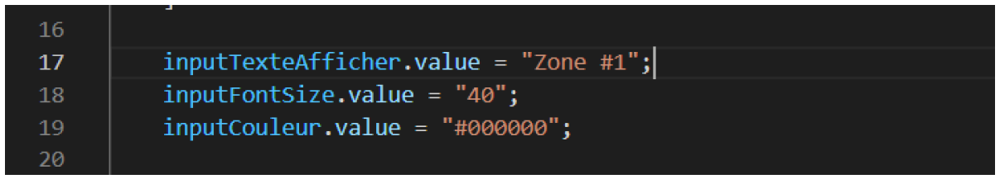{.center .shadow}
  <figcaption><a href="../../images/js_degub_02.png" target="_blank">Taille réelle</a></figcaption>
</figure>

J'essaie de changer la valeur de inputTexteAfficher mais selon le message d'erreur il est égale à null, donc ça créer une erreur. Si je remonte dans le script pour vérifier quand inputTexteAfficher est déclaré et assigné, j'ai ceci : 

<figure markdown>
  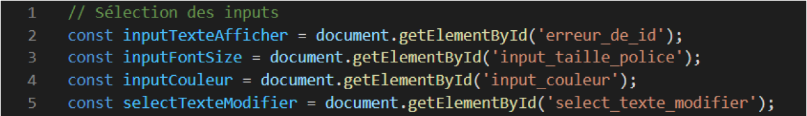{.center .shadow}
  <figcaption><a href="../../images/js_degub_03.png" target="_blank">Taille réelle</a></figcaption>
</figure>

En vérifiant la ligne 2, je trouve que j'ai fait une erreur dans le id de l'élément que j'essaie de récupérer à la 2. Je corrige, recharge la page et voilà! Le problème est réglé. Malheureusement ce n'est pas toujours aussi simple et il faut habituellement chercher plus profondément.

### Entrer des commandes à la console

Avec la console on peut aussi entrer directement du code et interagir avec la page affichée. 

<figure markdown>
  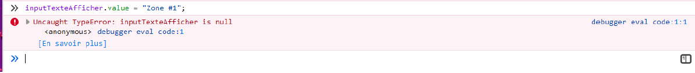{.center .shadow}
  <figcaption><a href="../../images/js_degub_04.png" target="_blank">Taille réelle</a></figcaption>
</figure>

J'ai reproduit ici l'erreur précédente. Je peux même essayer de corriger le problème par la console. Les modifications ne seront pas inscrites dans le fichier de script mais ça peut être pratique pour tester une solution rapidement.

<figure markdown>
  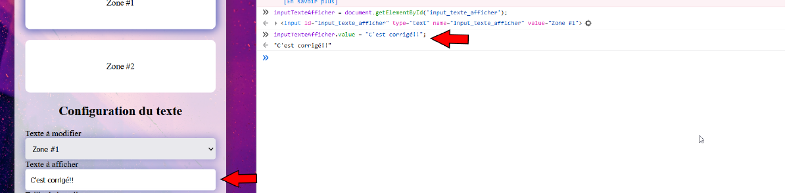{.center .shadow}
  <figcaption><a href="../../images/js_degub_05.png" target="_blank">Taille réelle</a></figcaption>
</figure>

Depuis la console on peut accéder à tous les éléments de nos scripts (variables, fonctions, etc.) ainsi que les éléments du DOM.

<figure markdown>
  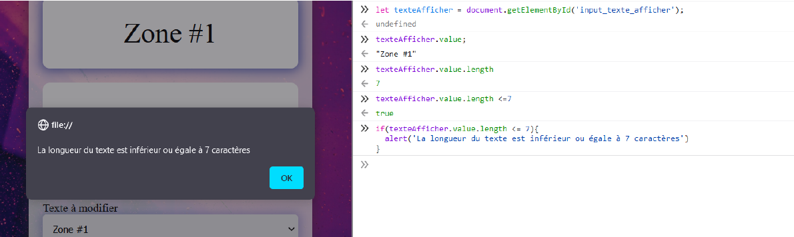{.center .shadow}
  <figcaption><a href="../../images/js_degub_06.png" target="_blank">Taille réelle</a></figcaption>
</figure>

### Afficher des messages à la console depuis nos scripts

On peut aussi faire afficher nos propres messages dans la console depuis nos scripts avec les commandes suivantes : - - -

- console.log('Message avec console.log');
- console.debug('Message avec console.debug');
- console.warn("Message avec console.warn");
- console.info("Message avec console.info");
- console.error("Message avec console.error");

La différence entre les différentes commandes sera la façon dont le message sera affiché

<figure markdown>
  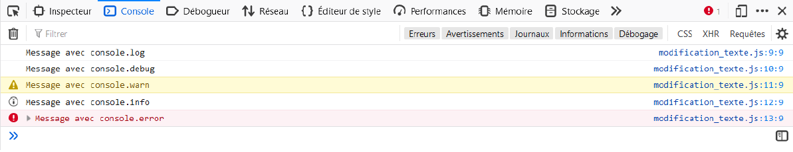{.center .shadow}
  <figcaption><a href="../../images/js_degub_07.png" target="_blank">Taille réelle</a></figcaption>
</figure>

On peut autant afficher du texte que la valeur d'une variable : 

<figure markdown>
  {.center .shadow}
  <figcaption><a href="../../images/js_degub_08.png" target="_blank">Taille réelle</a></figcaption>
</figure>

<figure markdown>
  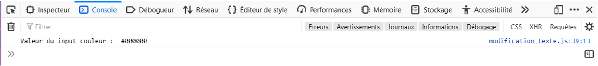{.center .shadow}
  <figcaption><a href="../../images/js_degub_09.png" target="_blank">Taille réelle</a></figcaption>
</figure>

Il est aussi possible d'afficher des données sous forme de tableau avec console.table : 

<figure markdown>
  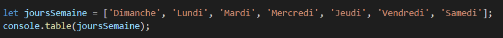{.center .shadow}
  <figcaption><a href="../../images/js_degub_10.png" target="_blank">Taille réelle</a></figcaption>
</figure>

<figure markdown>
  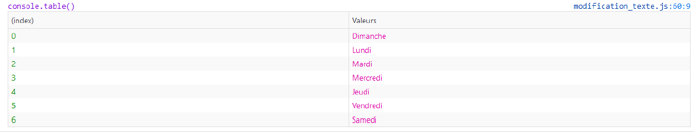{.center .shadow}
  <figcaption><a href="../../images/js_degub_11.png" target="_blank">Taille réelle</a></figcaption>
</figure>

Pour plus de détail sur les possibilités de console.table : 

- [https://developer.mozilla.org/en-US/docs/Web/API/console/table](https://developer.mozilla.org/en-US/docs/Web/API/console/table){target=_blank}

### Utilisation de points d'arrêt

Dans l'onglet source, on retrouve les différents fichiers javascript qui sont utilisés par la page. On peut ajouter des points d'arrêts dans ces fichiers en cliquant sur le numéro de la ligne.

<figure markdown>
  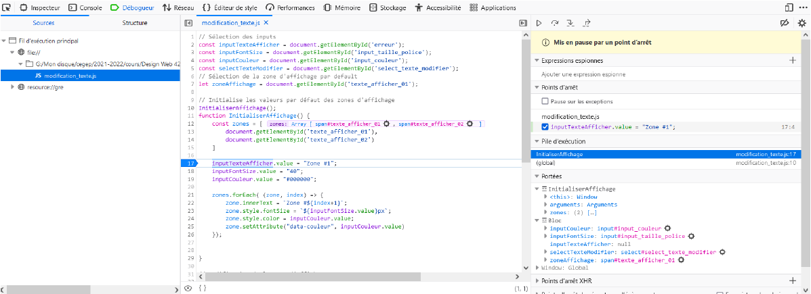{.center .shadow}
  <figcaption><a href="../../images/js_degub_12.png" target="_blank">Taille réelle</a></figcaption>
</figure>

J'ai placé ici un point d'arrêt à la ligne 17 pour tester l'erreur de id dans les exemples plus haut. On peut aussi voir dans la fenêtre de droite à la section **Portées** les valeurs et la portée des variables. On peut immédiatement y voir que la variable inputTextAfficher qui cause le problème est null.

### Ajouter un point d'arrêt dans le code

Dans les scripts on peut utiliser **debugger;** pour forcer l'arrêt de l'exécution du script. L'effet est le même que le point d'arrêt

### Options du débogueur

Une fois l'exécution du script arrêté par un point d'arrêt, plusieurs options s'offrent à nous. 

- Reprendre l'exécution
- Exécuter le code ligne par ligne
- Si la ligne en cours appelle une fonction, "entrer" dans la fonction.
- Si on est dans une fonction, sortir de la fonction

On retrouve ses options dans le coin supérieur droit de la fenêtre du débogueur.

<figure markdown>
  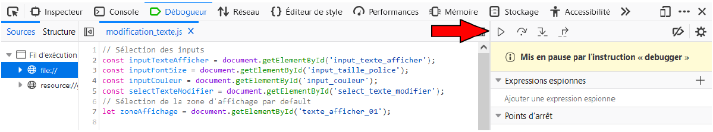{.center .shadow}
  <figcaption><a href="../../images/js_degub_13.png" target="_blank">Taille réelle</a></figcaption>
</figure>