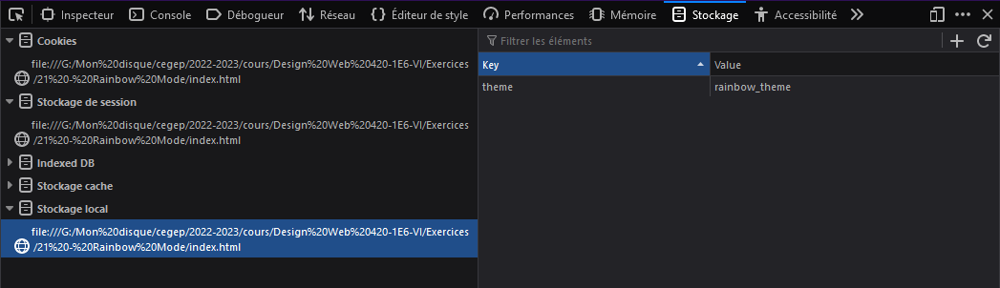

# Stocker de l'information dans le navigateur


On peut stocker de l'information directement dans le navigateur avec les objets **localStorage** et **sessionStorage**. La différence entre les deux est que les informations stockés avec **localStorage** survivent même si on redémarre le navigateur alors qu'avec **sessionStorage** les données peuvent survivre à un rafraichissement de la page uniquement. Ces deux objets fonctionnent un peu comme un cookie mais avec certaines différences. On utilise les cookies surtout au niveau "serveur" du site internet alors que les objets "storage" seront utilisés du côté client. 

Qu'on utilise **localStorage** ou **sessionStorage** les données à sauvegarder sont saisie sous la forme clé/valeur. La valeur à sauvegarder doit être du texte (string). Dans le cas contraire (un nombre, un booléen, un objet, etc...) la valeur sera convertie automatiquement en texte.

## Ajouter une valeur

La fonction **setItem(clé, valeur)** permet d'ajouter une valeur

``````js
localStorage.setItem('prenom', 'Mathieu');
``````

## Récupérer une valeur

La fonction **getItem(clé)** permet de récupérer une valeur. Elle retournera NULL si la clé n'est pas trouvé. On peut donc s'en servir aussi pour tester si la clé existe dans le stockage local.

``````js
// Retourne la valeur de la clé prenom 
let prenom = localStorage.getItem('prenom');

// Teste si la clé prénom existe dans le stockage local
if (localStorage.getItem('prenom') === null) {
  // ...
}
``````

## Supprimer une valeur

La fonction **removeItem(clé)** permet de supprimer une valeur du stockage. On peu aussi supprimer toutes les valeurs avec **clear()**.

``````js
// Supprime l'entrée prenom du stockage
localStorage.removeItem('prenom');

// Supprime toutes les entrées
localStorage.clear;
``````


## Visualiser les valeurs depuis le navigateur

On peut voir les valeurs qui sont enregistrées depuis notre navigateur. Ouvrez l'inspecteur et allez dans l'onglet **Stockage** pour Firefox ou **Application** pour Chrome. 

<figure markdown>
  {.center .shadow}
</figure>
