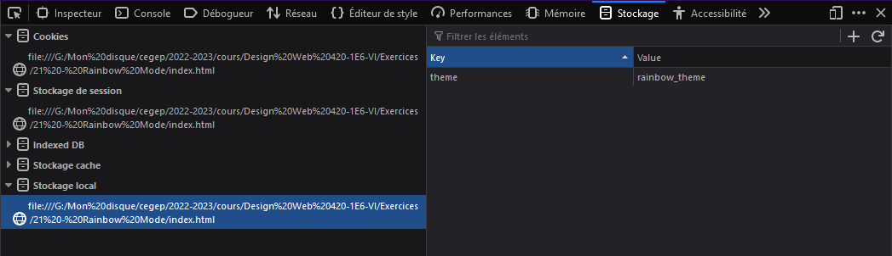

# Stocker de l'information dans le navigateur


On peut stocker de l'information directement dans le navigateur avec les propriétés [**localStorage**](https://developer.mozilla.org/fr/docs/Web/API/Window/localStorage){target=_blank} et [**sessionStorage**](https://developer.mozilla.org/fr/docs/Web/API/Window/sessionStorage){target=_blank} de l'API Web Storage. Ces deux propriétés fonctionnent un peu comme un cookie mais avec certaines différences. On utilise les cookies surtout au niveau "serveur" du site internet alors que les objets "storage" seront utilisés du côté client. 

## Différences entre les 2 propriétés

| Caractéristique | `localStorage` | `sessionStorage` |
|---|---|---|
| **Durée de vie** | Illimitée (jusqu'à suppression explicite) | Jusqu'à la fermeture de l'onglet ou de la fenêtre |
| **Survit à la fermeture du navigateur** | Oui | Non |
| **Survit au rechargement de la page** | Oui | Oui |
| **Portée** | Partagé entre tous les onglets et fenêtres de la même origine | Propre à chaque onglet |
| **Navigation vers une autre page du même site** | Conservé | Conservé (dans le même onglet) |
| **Ouverture dans un nouvel onglet** | Partagé avec le nouvel onglet | Copié au moment de l'ouverture, puis indépendant |


<!-- | **Capacité approximative** | ~5 Mo par origine | ~5 Mo par origine |
| **Type de données** | Chaînes de caractères uniquement | Chaînes de caractères uniquement |
| **API** | Synchrone | Synchrone |
| **Envoyé au serveur** | Non | Non |
| **Accessible par JavaScript** | Oui (même origine) | Oui (même origine) |
| **Méthodes** | `setItem`, `getItem`, `removeItem`, `clear`, `key`, `length` | `setItem`, `getItem`, `removeItem`, `clear`, `key`, `length` |
| **Cas d'usage typiques** | Meilleur score, préférences, thème, sauvegarde de partie | État temporaire, formulaire multi-étapes, données propres à une visite | -->

---

## Format des données

Qu'on utilise **localStorage** ou **sessionStorage** les données à sauvegarder sont saisie sous la forme clé/valeur. La valeur à sauvegarder doit être du texte (string). Dans le cas contraire (un nombre, un booléen, un objet, etc...) la valeur sera convertie automatiquement en texte.

### Texte et nombre
```javascript title="" 
localStorage.setItem("pseudo", "Math");
// On peut fournir un nombre comme valeur
localStorage.setItem("score", 1200);

console.log(localStorage.getItem("pseudo")); // "Math"
console.log(localStorage.getItem("score"));  // "1200" (le nombre a été converti en texte)

// Pour retrouver un nombre
const score = Number(localStorage.getItem("score")); // 1200
```

### Objet

Il faut convertir l'objet sinon il sera transformé en `"[object Object]"` et les données seront perdues. Pour régler le problème on va utiliser le format [JSON](https://developer.mozilla.org/fr/docs/Learn_web_development/Core/Scripting/JSON){target=_blank}.

Voici les deux méthodes à utiliser: 

- [`JSON.stringify`](https://developer.mozilla.org/fr/docs/Web/JavaScript/Reference/Global_Objects/JSON/stringify){target=_blank} pour stocker l'objet (Le convertir en chaine JSON)
- [`JSON.parse`](https://developer.mozilla.org/fr/docs/Web/JavaScript/Reference/Global_Objects/JSON/parse){target=_blank} pour le récupérer (Convertir une chaine JSON en objet JavaScript)

```JavaScript title="" 
const joueur = { nom: "Math", niveau: 3 };

// Mauvaise méthode : stocke "[object Object]"
localStorage.setItem("joueur", joueur);

// Bonne méthode
localStorage.setItem("joueur", JSON.stringify(joueur));
const joueurRecupere = JSON.parse(localStorage.getItem("joueur"));
console.log(joueurRecupere.nom); // "Math"
```

### Tableau

C'est le même principe que pour un objet

```JavaScript title=""
const scores = [1200, 950, 800];

localStorage.setItem("scores", JSON.stringify(scores));
const scoresRecuperes = JSON.parse(localStorage.getItem("scores"));
console.log(scoresRecuperes[0]); // 1200
```

---

## Manipulation des valeurs

### Ajouter une valeur

La méthode `setItem(clé, valeur)` permet d'ajouter une valeur

``````js
localStorage.setItem('prenom', 'Mathieu');
``````

### Récupérer une valeur

La méthode `getItem(clé)` permet de récupérer une valeur. Elle retournera NULL si la clé n'est pas trouvé. On peut donc s'en servir aussi pour tester si la clé existe dans le stockage local.

``````js
// Retourne la valeur de la clé prenom 
let prenom = localStorage.getItem('prenom');

// Teste si la clé prénom existe dans le stockage local
if (localStorage.getItem('prenom') === null) {
  // La clé n'existe pas
}
``````

### Supprimer une valeur

La méthode `removeItem(clé)` permet de supprimer une valeur du stockage. On peu aussi supprimer toutes les valeurs avec `clear()`.

``````js
// Supprime l'entrée prenom du stockage
localStorage.removeItem('prenom');

// Supprime toutes les entrées
localStorage.clear;
``````

---

## Visualiser les valeurs depuis le navigateur

On peut voir les valeurs qui sont enregistrées depuis notre navigateur. Ouvrez l'inspecteur et allez dans l'onglet **Stockage** pour Firefox ou **Application** pour Chrome. 

<figure markdown>
  {.center .shadow}
</figure>
