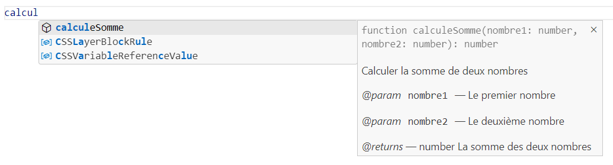

# Qualité du code

Maintenir une bonne qualité de code est primordial pour la compréhension et le partage avec les pairs. Dans le cadre de ce cours nous allons mettre l'accent sur ces trois facettes: les variables, l'indentation et la documentation des fonctions.

## Les variables

Un nom de variable peut être composé de lettre, chiffre et des caractères $ et _. Le premier caractère ne doit pas être un chiffre. Si le nom de la variable comporte plus d'un mot, on va utiliser la notation [camelCase](https://fr.wikipedia.org/wiki/Camel_case){target=_blank} : on supprime les espaces, le premier mot en minuscule mais les suivants commenceront par une lettre majuscule. Attention, le nom de variable est aussi sensible à la case.

`````js
// Exemple de nom en camelCase
let nomEnCamelCase = 'Hallo!';
// Les deux variables sont différentes
let message = 'Message 1';
let messAge = 'Message 2';
`````

Pour les constantes, la norme veux qu'on mettre le nom entièrement en majuscule avec les différents mots séparés par un _ quand la valeur est "hardcodé" (attribué dans le code lors de la déclaration). Sinon on utilise le camelCase comme avec les variables.

``````js
// La valeur est ici hardcodé
const COULEUR_ORANGE = '#ffaa00';
// On assigne la constant avec le résultat de la fonction calculAge()
const monAge = calculAge(dateDeNaissance);
``````

En règle générale on doit éviter les noms de variable trop court ou non significatif.

``````js
// Le nom ne veut rien dire
let a = 'Mon titre';
// C'est beaucoup plus significatif avec ce nom
let texteTitre = 'Mon titre'

``````

## L'indentation

L'indentation consiste à insérer des tabulations à des endroits stratégiques pour faciliter la lecture du code et éviter les erreurs. Prenons ces deux extraits de codes, l'un avec une indentation déficiente et l'autre avec une bonne indentation. Selon vous lequel est le plus clair?

```javascript title="Exemple sans indentation" linenums="1"
function somme(tableau) {
let valeur = 0;

for (let i = 0; i < tableau.length; i++) {
if(tableau[i] >= 24.37) {
valeur += 3;
} 
else if (tableau[i] >= 13.54) 
{
valeur = valeur + 2;
} else if (tableau[i] >= 1.35) {
valeur += 1;


}  
}
return valeur;
}
```

```javascript title="Exemple avec indentation" linenums="1"
function somme(tableau) {
    let valeur = 0;

    for (let i = 0; i < tableau.length; i++) {
        if(tableau[i] >= 24.37) {
            valeur += 3;
        } else if (tableau[i] >= 13.54) {
            valeur = valeur + 2;
        } else if (tableau[i] >= 1.35) {
            valeur += 1;
        }  
    }

    return valeur;
}
```

!!! Astuce

    La règle générale à retenir : à chaque fois qu'on ouvre une accolade, on indente les lignes suivantes jusqu'à la fermeture de l'accolade.


## Documenter les fonctions

Documenter les fonctions de manière structuré permet de mieux les comprendrent et de les utiliser. En plus la pluppart des IDE vont comprendre la documentation et vous afficher de l'aide en auto-complétion. Nous allons utiliser la syntaxe [**JSDoc**](https://jsdoc.app/){target=blank}.

Voici un exemple de fonction simple qui calcule la somme de deux nombres avec documentation

```javascript linenums="1"
/**
 * Calculer la somme de deux nombres
 * 
 * @param {number} nombre1 Le premier nombre
 * @param {number} nombre2 Le deuxième nombre
 * @returns number La somme des deux nombres
 */
function calculeSomme(nombre1, nombre2) {
    return nombre1 + nombre2;
}
```

- Le bloc de commentaire commence par le symbole /** et se termine par */. Chaque ligne commence par un *
- À la première ligne on va inscrire une courte de description sur une ligne.
- Ensuite en utlisant le mot clé {==@param==} on définit chaque paramêtre de la fonction en donnant aussi le type de donnée attendu et le nom du paramêtre.
- Finalement avec {==@returns==} on donne le type de donnée que la fonction va retourner et une description de ce que représente ces données.

Ajoutez les lignes *@param* seulement si la fonction reçoit des paramêtres et *@returns* si elle retourne une valeur.

Ensuite quand vous allez inscrire la fonction dans votre code, l'auto-complétion va lire la documentation et vous l'afficher. Voici un exemple avec vsCode.

{.center .shadow}

Il y a plusieurs mot-clés qu'on peut utiliser mais dans le cadre du cours nous allons nous en tenir à *@param* et *@returns*.


## Sources

- Syntaxe et indentation : [https://javascript.info/coding-style](https://javascript.info/coding-style){target=_blank}
- Commentaire : [https://javascript.info/comments](https://javascript.info/comments){target=blank}
- JSDoc : [https://jsdoc.app/](https://jsdoc.app/){target=blank}
- JSDoc (Wikipedia) : [https://en.wikipedia.org/wiki/JSDoc](https://en.wikipedia.org/wiki/JSDoc){target=blank}