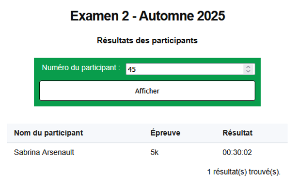
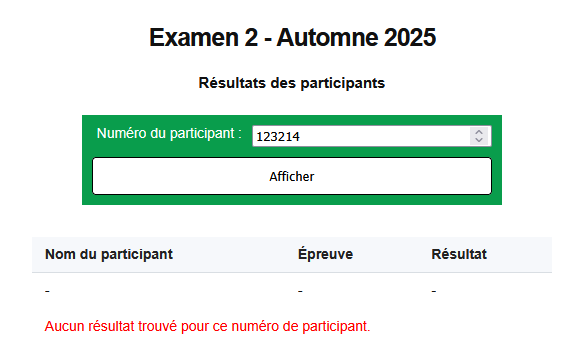

# Examen 2 - Révision A

## Directives

- Téléchargez le fichier [examen2_revision_a.zip](../../ressources/examen2_revision_a.zip)
- Les consignes sont dans le fichier **Examen 2 - Énoncé.pdf**
- Ne pas tenir compte des sections **Consignes** et de tout ce qui est en lien avec **Github**

## Question 1 – Formulaire d’inscription

Dans le fichier question1.html reproduisez le formulaire suivant : 

<figure markdown>
  {.center .shadow}
  <figcaption></figcaption>
</figure>

Des règles css sont déjà présentent dans le fichier styles.css pour aligner le formulaire. La disposition ne sera pas évaluée.
Faites le nécessaire pour que chaque champ du formulaire puisse répondre aux exigences suivantes : 

- [x] **Nom et prénom** : 
    - Champ texte et obligatoire
    - Doit être d’une longueur comprise entre 2 et 30 caractères
- [x] **Courriel** :
    - Champ obligatoire
    - Doit être une adresse courriel valide
- [x] **Téléphone** :
    - Champ obligatoire
    - Doit être testé avec l'expression régulière suivante : 
    - `[0-9]{3}-[0-9]{3}-[0-9]{4}`
- [x] **Date de naissance** :
    - Champ obligatoire
    - Ne doit être supérieur à la date d’aujourd’hui (vous pouvez l’écrire en clair)
- [x] **Épreuve** :
    - Champ obligatoire
    - Doit être représenté sous forme de liste avec 5 options :
        - Option 1: « --Sélectionnez une épreuve-- », valeur vide
        - Option 2: « 5 km - Débutant (25$) », valeur égale à 5km
        - Option 3: « 10 km - Intermédiaire (35$) », valeur égale à 10km
        - Option 4: « 21 km - Semi-marathon (50$) », valeur égale à 21km
        - Option 5: « 42 km - Marathon (75$) », valeur égale à 42km
- [x] **Commentaires**:
    - Pas obligatoire
    - Zone de texte de 30 colonnes et 5 rangées.
- [x] **Case à cocher "J'accepte les conditions de participation"** :
    - Case obligatoire


!!! info "Précisions"

    - Le formulaire doit envoyer les données par la méthode **POST**.
    - Les données sont envoyées à l'adresse suivante : 
    
    ```
    https://design-web.onrender.com/submit
    ```

## Question 2 – Affichage des résultats

Dans le fichier **question2.html** vous avez déjà des éléments en place pour permettre d’afficher les résultats d’un coureur selon son numéro de participant.

Dans le fichier **script.js** vous avez un tableau d’objets (résultats) qui contient les résultats de 70 participants. 

Vous devez programmer une fonctionnalité de recherche et d’affichage du résultat selon un numéro de participant en respectant les consignes suivantes.

- Vous ne pouvez pas modifier le fichier html. Tout le traitement doit uniquement se faire dans le fichier **script.js**.
- Le tableau résultats ne peut pas être modifier non plus.
- Quand l’utilisateur clique sur le bouton « Afficher », faites une recherche du numéro du participant dans le tableau résultats.
- Un participant peut avoir fait plus d’une épreuve, donc vous pourriez avoir plus d’un résultat (Par exemple le participant 42 a 3 résultats).
- Avant d’afficher les résultats, effacez le contenu de la section <tbody> du tableau.

### Si vous trouvez un ou plusieurs résultats

Pour chacun des résultats :

- Créez une nouvelle ligne de tableau.
- Créez trois nouvelles cellules de tableau qui contiendront : 
    - Le prénom et le nom du participant
    - Le nom de l’épreuve
    - Le résultat
- Ajoutez ces cellules en ordre dans la nouvelle ligne
- Ajoutez ensuite la nouvelle ligne dans la balise `<tbody>` du tableau.
- Dans la cellule avec le id **resultat-message**, inscrivez le nombre de résultats trouvés : `x résultat(s) trouvé(s)`.
- Ajoutez à cette cellule la classe recherche-trouve et enlever la classe erreur.

### Si vous ne trouvez pas de résultats

- Créez une nouvelle ligne de tableau.
- Créez trois nouvelles cellules de tableau qui contiendront chacune un tiret ("-").
- Ajoutez ces cellules en ordre dans la nouvelle ligne
- Ajoutez ensuite la nouvelle ligne dans la balise <tbody> du tableau.
- Dans la cellule avec le id **resultat-message**, inscrivez « Aucun résultat trouvé pour ce numéro de participant ».
- Ajoutez à cette cellule la classe **erreur** et enlever la classe recherche-trouve.

<figure markdown>
  {.center .shadow}
  <figcaption></figcaption>
</figure>

<figure markdown>
  {.center .shadow}
  <figcaption></figcaption>
</figure>